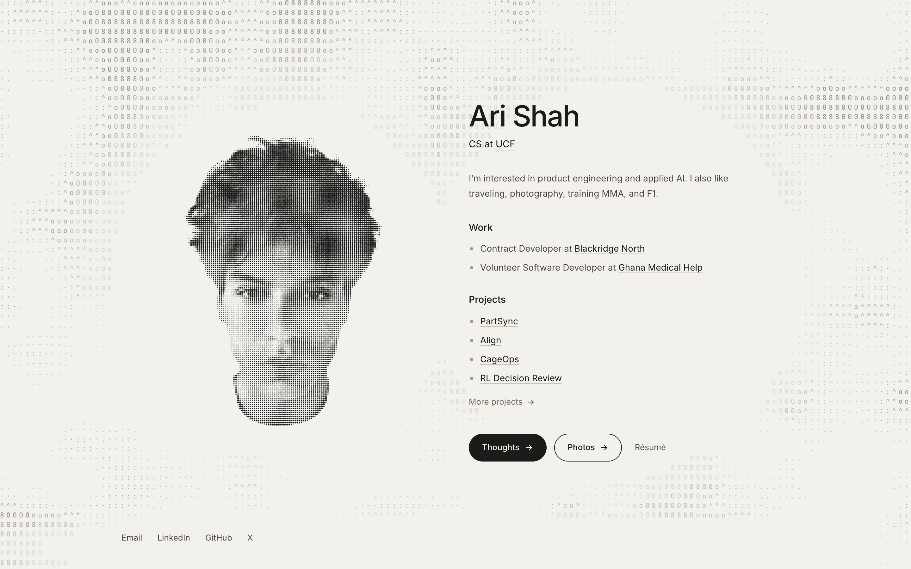

<div align="center">

# ar13.dev

**My personal site: a homepage, project list, photo gallery, and Markdown-based blog, built to be quick to load and easy to update.**


[](https://ar13.dev)

</div>



**Tech:** TypeScript · Next.js 16 · React 19 · Tailwind CSS 4 · Vercel

---

## Overview

I wanted a personal site where adding a project, a photo, or a post meant editing one file, not touching a CMS or a database. Most portfolio templates also look the same, so I wanted the homepage to have a bit of personality without slowing the page down.

I built it solo as a small Next.js app. Projects and photos are typed arrays in `src/content/`, posts are Markdown files in `src/content/thoughts/`, and the two animated parts of the homepage (the halftone portrait and the ASCII background) are drawn on canvas with no animation library.

## Features

**The homepage portrait draws itself.** `src/components/HalftonePortrait.tsx` turns a grayscale photo into a grid of dots sized by darkness, like a print halftone, and pops them in from the center outward.

**The background stays out of the way.** `src/components/AsciiBackground.tsx` drifts a field of ASCII characters behind the page and fades it out around anything marked `data-ascii-clear`, so the text and portrait stay readable.

**Hovering a link shows a preview card.** Links to my school and work show a small card with a screenshot of the site, built with CSS only (`src/components/PreviewLink.tsx`).

**Adding content is a one-file change.** A new project goes in `src/content/projects.ts`, a photo in `src/content/photos.ts`, and a post is a Markdown file with front matter.

## Tech Stack

| Layer | Technology | Notes |
| ----- | ---------- | ----- |
| App framework | [Next.js](https://nextjs.org/) (App Router) | Pages, metadata, `sitemap.ts`, `robots.ts`, and the Open Graph image. |
| UI | [React](https://react.dev/) | Server components for pages, client components only for the two canvas animations and the photo gallery. |
| Styling | [Tailwind CSS](https://tailwindcss.com/) | Utility classes with the Turbopack loader configured in `next.config.ts`. |
| Language | [TypeScript](https://www.typescriptlang.org/) | Typed content (`Project`, `Photo`, `PostMeta`) so a bad entry fails at build time. |
| Content | [gray-matter](https://github.com/jonschlinkert/gray-matter) + [unified](https://unifiedjs.com/) | Parses post front matter and renders Markdown (with GFM tables) to HTML in `src/lib/posts.ts`. |
| Fonts | [Inter](https://rsms.me/inter/) and [JetBrains Mono](https://www.jetbrains.com/lp/mono/) | Self-hosted `.woff2` files in `src/app/fonts/`. |
| Hosting | [Vercel](https://vercel.com/) | Deployed from this repo. |

## Engineering Decisions

**Drawing the portrait as canvas dots instead of shipping a pre-rendered image.** A static halftone PNG would be sharp at one size and blurry or oversized everywhere else, and it could not animate. `HalftonePortrait.tsx` instead reads `public/portrait.png` into a 130-column lightness grid, builds one dot per cell with radius proportional to the square root of darkness (so dot area tracks darkness, like real halftone), and redraws on resize. Each dot has its own easing delay based on its distance from the center, which is what makes the portrait pop in as a wave. The animation pauses through an `IntersectionObserver` when the canvas is off screen and is skipped entirely when `prefers-reduced-motion` is set.

**Measuring the layout instead of hard-coding where the background should fade.** The ASCII field has to avoid the portrait and the text column, but those move around between desktop and stacked mobile layouts. Hard-coded coordinates would break at some width. `AsciiBackground.tsx` instead finds every element with `data-ascii-clear`, turns its bounding box into an ellipse, and builds a per-cell opacity mask from the distance to the nearest one. The mask only depends on layout, so it is built once per resize and the per-frame work is just noise lookups. Characters are also drawn in four opacity buckets so `fillStyle` changes only four times a frame.

**Keeping the hover cards pure CSS.** The obvious way to build a preview card is a client component with hover state and a portal. That would put JavaScript on the homepage for something purely decorative. `PreviewLink.tsx` is a server component that renders the card next to the link and reveals it with `group-hover` and `group-has-[a:focus-visible]`, so keyboard focus works too. It is gated behind `@media (hover: hover)`, so on touch screens the card never appears and the link just opens the site.

**Hiding drafts in production without a flag.** Posts are plain Markdown files, so I needed a way to write one without it going live. `getPosts()` in `src/lib/posts.ts` filters out posts with `draft: true` unless `NODE_ENV` is not `production`. Drafts show up in `npm run dev` for previewing and are never part of the production build or the sitemap.

<details>
<summary><b>Technical deep dive</b></summary>

**Core mechanic:** Content lives in `src/content/` as typed data and Markdown, pages read it at build time, and the only client-side code is the two canvas animations and the photo lightbox.

### Architecture notes

- **Content is data, not CMS.** Featured projects on the homepage come from `featured: true` in `src/content/projects.ts`, and the same list feeds `/projects`.
- **Posts are read from disk at build time.** `src/lib/posts.ts` reads `src/content/thoughts/*.md`, parses front matter with `gray-matter`, and renders HTML through `unified` with `remark-gfm`, sorted newest first by `date`.
- **Only three components are client components.** `HalftonePortrait`, `AsciiBackground`, and `PhotoGallery` need browser APIs (canvas, observers, keyboard events). Everything else renders on the server.
- **The photo gallery handles its own accessibility.** `PhotoGallery.tsx` locks body scroll while open, closes on Esc, moves with arrow keys, and returns focus to the photo that opened it.
- **The sitemap is generated, not hand-written.** `src/app/sitemap.ts` lists the static pages plus every non-draft post from `getPosts()`, and `src/app/robots.ts` points crawlers at it.

### Route map

| Area | Routes |
| ---- | ------ |
| Home | `/` |
| Projects | `/projects` |
| Photos | `/photos` |
| Thoughts | `/thoughts`, `/thoughts/[slug]` |

### Project structure

```text
ar13/
├── public/
│   ├── photos/                  # Photo gallery images
│   ├── previews/                # Hover card screenshots
│   ├── portrait.png             # Source image for the halftone portrait
│   └── Ari_Shah_Resume.pdf
├── src/
│   ├── app/                     # Routes, layout, fonts, sitemap, robots, OG image
│   ├── components/              # HalftonePortrait, AsciiBackground, PreviewLink, PhotoGallery
│   ├── content/                 # projects.ts, photos.ts, thoughts/*.md
│   └── lib/                     # site.ts (socials, preview cards), posts.ts (Markdown loader)
└── docs/home.png                # README screenshot
```

</details>

<details>
<summary><b>Run it locally</b></summary>

### Prerequisites

- Node.js 20 or newer
- npm

### Setup

```bash
git clone https://github.com/ar1shah/ar13.git
cd ar13
npm install
npm run dev      # http://localhost:3000
```

### Useful scripts

| Script | Command |
| ------ | ------- |
| `npm run dev` | Start the dev server (drafts are visible) |
| `npm run build` | Production build |
| `npm run start` | Serve the production build |
| `npm run lint` | Run ESLint |

### Adding content

- **Project:** add an entry to `src/content/projects.ts` (`featured: true` shows it on the homepage).
- **Photo:** drop the file in `public/photos/` and list it in `src/content/photos.ts`.
- **Post:** add `src/content/thoughts/my-post.md` with `title`, `date`, `summary`, and `draft` front matter.

</details>

---

This is my personal site, live at [ar13.dev](https://ar13.dev).

Ari Shah · [Portfolio](https://www.ar13.dev/) · [LinkedIn](https://linkedin.com/in/arishah)
